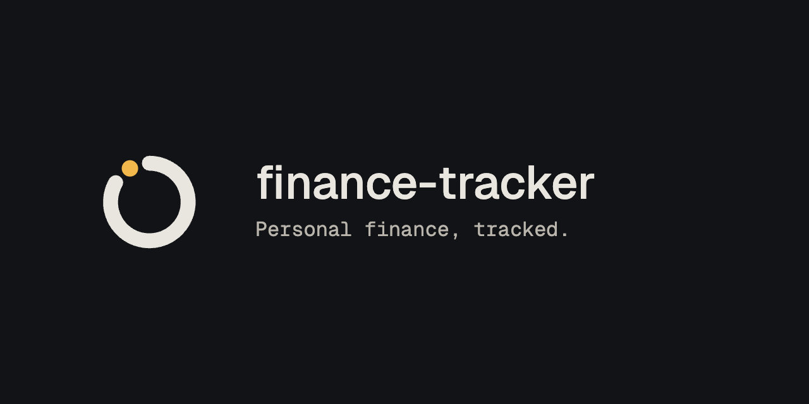

<h1>
  
  finance-tracker
</h1>

<p align="center">
  
</p>

A local-first personal finance tracker built from bank statement PDFs. It parses
your statements, refuses any statement whose balances do not reconcile,
categorises transactions by rules you write (it never guesses), and shows the
result on a dashboard. Everything runs on your own machine; nothing is uploaded.

Accounts can be in more than one currency: SGD is the base, and accounts in
other currencies (such as MYR) are kept alongside.

The currency picker in the top bar chooses how money is shown:

- **Original currency** (the default): totals are in SGD, and a ringgit account
  is shown on its own, in RM, never added into them. No rate, so no figure is
  approximate.
- **All in SGD** or **All in MYR**: every account is added together, each
  amount converted at the latest exchange rate (European Central Bank reference
  rates, fetched at most twice a day; only the currency codes are sent). These
  are rough figures, marked with "≈"; hover one to see the original amount.
  Nothing stored changes - switching back shows the exact original amounts.
  Statements, Reconcile and Review always show original amounts.

Some banks send password-protected PDFs; the app cannot open those yet, so
save an unprotected copy first and upload that.

```
finance/    the app: Next.js + SQLite
desktop/    optional macOS app that opens it with a double-click
```

---

## Install the app (macOS)

No Node, git or setup needed.

1. Open the [latest release](https://github.com/Yong-Ching/finance-tracker/releases/latest)
   and download the DMG for your Mac: `arm64` for Apple Silicon (M1 and later),
   `x64` for Intel. Not sure? Apple menu → **About This Mac** → *Chip*.
2. Open the DMG and drag **Finance Tracker** into **Applications**.
3. The first time only: open it, and when macOS says it can't verify the app,
   click **Done**. Then go to **System Settings → Privacy & Security**, scroll
   down to *"Finance Tracker" was blocked*, and click **Open Anyway**. (The app
   isn't signed with a paid Apple developer certificate, so macOS asks once.)

### Updating

The app checks for a new version each time it opens, and from **Finance Tracker
→ Check for Updates…**. When one is out, click **Update and Restart**: it
downloads the new version, replaces itself and reopens, in a minute or so. Your
data is kept: it lives outside the app, in `~/Library/Application Support/Finance Tracker/`.

### Settings

**Data → Edit Settings…** opens a settings file where you can add a Claude API
key to turn on the Review page (see step 5 below for what that does). Restart
the app after editing. **Data → Show Data Folder** shows your database and
stored statements; copy that folder while the app is closed to back it up.


### Sorting with an AI assistant

Instead of filing transactions one at a time, you can ask an AI assistant to do
it. **Data → Connect an AI Assistant** lists the supported apps found on your
Mac - Claude Desktop, Claude Code, Codex (the CLI, the IDE extension and Codex
in the ChatGPT app), Cursor, Windsurf, VS Code (Copilot), Gemini CLI and
LM Studio - with a tick beside each one connected. Pick one, then quit and
reopen it (or start a new session), and ask something like:

> Group my uncategorised transactions by merchant and suggest a category for each.

For any other app that supports MCP servers, **Copy Setup for Another App…**
copies the standard setup to paste into its MCP settings. Ordinary ChatGPT chats
cannot use it: ChatGPT only connects to MCP servers on the internet, and this
one runs on your Mac alone. Codex inside the ChatGPT app can.

The assistant can list and search your transactions, summarise a month, file
whole groups into a category, add remarks, and create rules so next month's
statement sorts itself. It cannot delete anything. Every change is recorded
like one you made by hand, and your database is backed up before its first
change each session.

**Privacy:** what the assistant reads is sent to the company that runs its AI
model, to answer you. LM Studio is the exception - it runs the model on your
Mac, so nothing leaves it (pick a model that supports tool use).

---

## Run from source

For changing the code, or running on Linux or Windows.

### 1. Install the prerequisites

- **Node.js 20.9 or newer** (tested on 22). Check with `node -v`.
  Get it from [nodejs.org](https://nodejs.org) or `brew install node`.
- **git**

### 2. Get the code

```sh
git clone https://github.com/Yong-Ching/finance-tracker.git
cd finance-tracker/finance
```

### 3. Install dependencies

```sh
npm install
```

### 4. Create the database

```sh
npm run db:migrate     # creates finance/data/sqlite.db
npm run db:seed        # adds the accounts, starter categories and transfer rules
```

Both are safe to run again: migrate only applies what is new, and the seed only
adds what is missing.

### 5. (Optional) Turn on the Claude review layer

The app works fully without this. If you want Claude to *suggest* categories for
transactions your rules don't cover:

```sh
cp .env.example .env.local
```

Then edit `.env.local`: set `ANTHROPIC_API_KEY`, and put your own name in
`FINANCE_OWNER_NAMES` so it is masked before anything is sent. Account numbers,
card numbers and references are always masked; balances are never sent.

### 6. Start it

```sh
npm run dev
```

Open **http://127.0.0.1:3000**. The dashboard is empty until you upload a statement.

### 7. (Optional, macOS) Install the desktop app

```sh
cd ../desktop
npm install
npm run install-app
```

This puts **finance-tracker** in `~/Applications` and a shortcut on your Desktop. It runs
your copy of `finance/` directly: when you change the code, the next launch
rebuilds by itself. Its **Develop → Connect an AI Assistant** connects the same
assistants as the installed app does (see *Sorting with an AI assistant* above),
on `finance/data`. Details are in [desktop/README.md](desktop/README.md).

---

## Using it

The routine is the same every month: upload, categorise, reconcile.

### 1. Upload a statement

1. Download the statement PDF from your bank's website or app.
2. Click **Upload statement** at the top right and choose the PDF.
3. Read the preview before importing: which account it detected, the period,
   whether the balances **reconcile** (opening balance + every transaction =
   closing balance), and every transaction it read - date, description, the
   category your rules give it, amount and running balance. Check them against
   the PDF; money out is negative. Rows already imported from another statement
   are shown greyed out and skipped.
4. Click **Looks right, import**. Nothing is saved until you do.

A statement from a bank the app has no parser for is read from its table
layout instead: it finds the header row (Date, Description, Debit/Credit or
Amount, Balance) and reads the rows under it. The preview then asks **which
account it is**: pick one, or create a new one (name, type and currency). Such a
statement is only imported when the reader found its opening and closing
balances and they reconcile; otherwise nothing is saved. Check its rows against
the PDF with extra care.

If the balances don't add up, the statement is **quarantined**: it is kept and
shown on **Accounts**, but left out of every total, so the dashboard is never
quietly wrong. Uploading the same file twice does nothing.

### 2. Categorise what the rules didn't catch

1. Go to **Transactions** and tick **Needs review**.
2. Pick a category for each row from its dropdown. To do many at once, tick
   their checkboxes and choose a category from the bar that appears. Or let an
   AI assistant sort a whole month for you (see *Sorting with an AI assistant*).
3. A manual choice always beats a rule, and survives deleting and re-importing
   the statement.

Picking a category also sets how the transaction counts: an expense category
makes it spending, an income category income. So money that comes **back**
into a spending category - a refund, or a friend paying you back - reduces that
spending instead of counting as income. When you pay for a friend, file both
your payment and their repayment under **Paid for friends**: they cancel out,
and what is left is what friends still owe you. For a shared bill, leave the
bill in its category (say Food) and file their share back into Food too.

To note what a transaction was for, hover its row and click **+ remark** under
the description (click a remark to change it). Search finds remarks as well
as descriptions.

To find a transaction by how much it was, use **Amount** in the filters: `3.98`
(exact), `10-50` (a range), `>100` or `<5`, `~30` (within 10%). Start with `-`
for money out only or `+` for money in only, e.g. `-~30`.

### 3. Write rules for payees that recur

1. Go to **Rules**. Enter a text the description contains (for example
   `NTUC FP`) and the category it belongs to.
2. Click **Add and backfill** to apply it to your history as well (**Add only**
   applies it to future uploads). An existing rule can be re-applied any time
   with its **Backfill** button.

Each month the review queue gets shorter as your rules grow.

### 4. Reconcile transfers to your own accounts

Moving money from your bank account to your own credit card or e-wallet is
**not spending**; the spending is whatever that
money bought, which only the card's or wallet's own statement shows. Until
that statement is uploaded, the money is shown as **Unaccounted** on the
dashboard (in its own currency for a ringgit wallet).

1. Upload the card or wallet statements as in step 1.
2. Go to **Reconcile**. It proposes matches between the two sides of each
   transfer by amount and date.
3. Confirm the ones that are right. Nothing is linked until you do.

### 5. Track your subscriptions

**Subscriptions** shows what you pay on repeat, and what that adds up to per
month and per year. A subscription is kept in its account's currency: one on
a ringgit account is shown in RM and totalled on its own, never added to
the S$ figure. **Any SGD account** matches across your SGD accounts; for a
ringgit bill, pick its account.

1. Under **Suggested**, the app lists charges that repeat at a steady amount and
   interval (an Apple plan, a phone bill). Click **Track** and give it a name, or
   **Dismiss** it if it is just a habit; dismissed ones never come back.
   A monthly bill whose amount changes every time (electricity, a phone plan
   with usage) is suggested too, marked **varies**.
2. Use **Add by hand** for anything the suggestions can't see yet, such as a
   yearly plan. Tick **Amount varies** for a bill that is never the same
   twice: it then matches any amount, and its monthly cost is the median of its
   last six charges (the amount you enter is only used until the first charge
   arrives). **Edit** switches an existing subscription either way.
3. Each tracked subscription shows its last charge and when the next is due. It
   is flagged if a charge is missed (judged against your latest statement, not
   today's date) or if the price of a fixed-amount one changes. Mark one **Cancelled** when you end it.
4. Click a subscription to trace it: every charge matched to it, each linked to
   the statement it appeared on (opens the original PDF), with missed months
   shown as gaps. **Show in Transactions** opens exactly those charges to edit.
   A suggestion expands the same way, so you can check it before tracking.

### 6. Read the dashboard

- Use the period picker (top right) to switch between a single month, the
  last 3 months, year to date or all time.
- Click any figure to see the transactions behind it.
- **Balance** is what your accounts hold now, from each one's latest
  statement, with a credit card's amount owed taken off. It does not follow the
  period picker.
- **Spending by category** is a donut of one month's spending (the five
  biggest categories plus Other) beside a table of the same figures. It has
  its own month picker; it starts on the month the period picker shows, or the
  latest month. Click a slice or row to see its transactions.
- **Review** shows Claude's suggestions, if you turned that on. Accepting a
  suggested rule also backfills it.

---

## Your data

When running from source (the installed app keeps the same files in
`~/Library/Application Support/Finance Tracker/`):

| What                    | Where                                      |
| ----------------------- | ------------------------------------------ |
| Database                | `finance/data/sqlite.db`                   |
| Copies of uploaded PDFs | `finance/data/statements/`                 |
| API key, your name      | `finance/.env.local`                       |
| Backups                 | `finance/data/backups/`: before each migration (desktop app), and before an AI assistant's first change each session |

All of these are gitignored. To back up, copy the `finance/data/` folder while
the app is closed.

## Updating a source checkout

```sh
git pull
cd finance
npm install
npm run db:migrate
```

The desktop app runs the migration and rebuild for you on its next launch;
you only need `git pull` and, if dependencies changed, `npm install`.

## Troubleshooting

| Problem                                    | Fix                                                                 |
| ------------------------------------------ | ------------------------------------------------------------------- |
| Upload says **Unknown account**            | Run `npm run db:seed` in `finance/`.                                |
| Upload says **No parser recognised this document** | Neither a bank parser nor the generic reader could find a transaction table. Scanned (image-only) PDFs cannot be read. |
| Upload says **Could not check this statement** | The generic reader read rows but found no opening/closing balance, or they don't add up, so nothing was saved. |
| Upload fails on a password-protected PDF   | The app cannot open those yet. Upload an unprotected copy.          |
| Port 3000 is already in use                | `npm run dev -- -p 3001`, then open http://127.0.0.1:3001           |
| Desktop app shows an error while starting  | The window shows the output; **Develop → Show Server Log** has all of it. |

---

## Changing the code

[finance/README.md](finance/README.md) explains how the app works and where
things live.

To publish a new version of the installable app, run
`npm run release -- patch` (or `minor`, `major`) in `desktop/`. It bumps the
version, asks for release notes, and pushes a tag; the release workflow builds
and publishes it, and installed apps offer the update on their next launch.
[desktop/README.md](desktop/README.md) covers building one locally.

```sh
cd finance
npm test               # unit tests (real-PDF tests skip without private fixtures)
npm run lint
```

### Keeping personal data out of git

This repo is public, and the folder it lives in may also hold real finances.

- The root `.gitignore` is an **allowlist**: only `finance/`, `desktop/` and
  repo files are ever tracked. Anything else you put in the folder stays local.
- Turn on the pre-commit guard once per clone:

  ```sh
  git config core.hooksPath .githooks
  ```

  It blocks commits containing statement PDFs, databases, env files, account or
  NRIC numbers, and anything you list (one per line) in a `.private-patterns`
  file at the repo root, such as your name, account numbers and payees. That
  file is never committed.
- Every push is reviewed before anything leaves the machine
  (`.githooks/review-push.sh`, run by the `pre-push` hook above):
  1. Local checks: personal file types, account/NRIC formats, your
     `.private-patterns`, and non-noreply commit emails. These never leave
     the machine.
  2. A clean Claude reviewer: a separate `claude -p`, started in an empty temp
     folder with every tool disabled, reads only the outgoing diff and commit
     messages and blocks anything that looks like real personal or financial
     data. If it can't run, the push is refused.

  This needs the [Claude Code](https://claude.com/claude-code) CLI signed in.
  To have Claude Code's own pushes reviewed the same way, add this to
  `.claude/settings.json`:

  ```json
  { "hooks": { "PreToolUse": [ { "matcher": "Bash", "hooks": [ {
    "type": "command", "timeout": 300,
    "command": "\"$CLAUDE_PROJECT_DIR\"/.githooks/review-push.sh claude"
  } ] } ] } }
  ```
- Tests use made-up data. Parser tests against real PDFs read their expected
  values from `finance/tests/fixtures/statements.local.json` (gitignored);
  `statements.example.json` shows the format.
